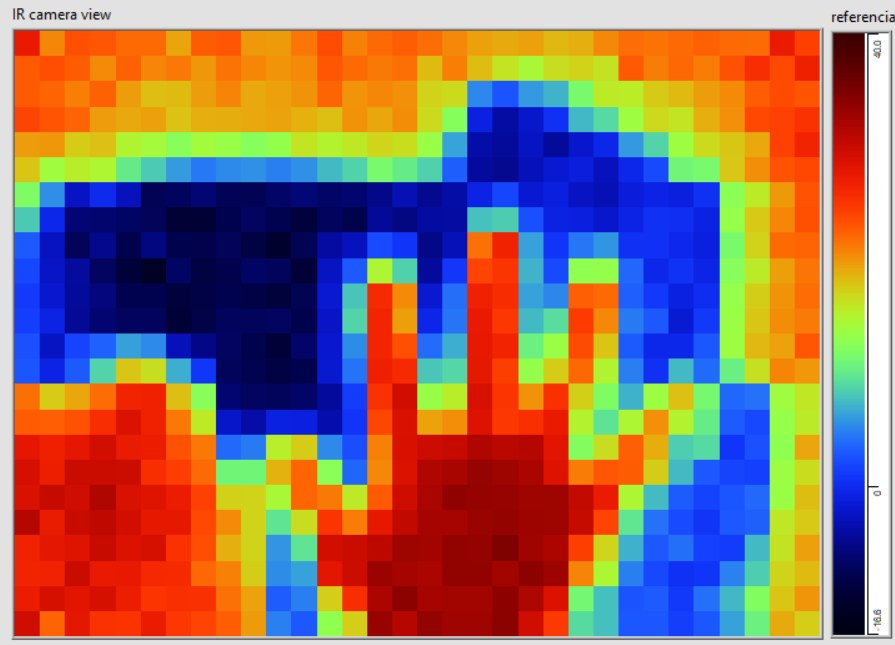
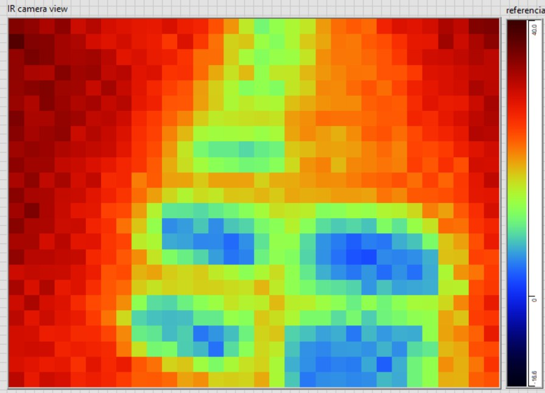
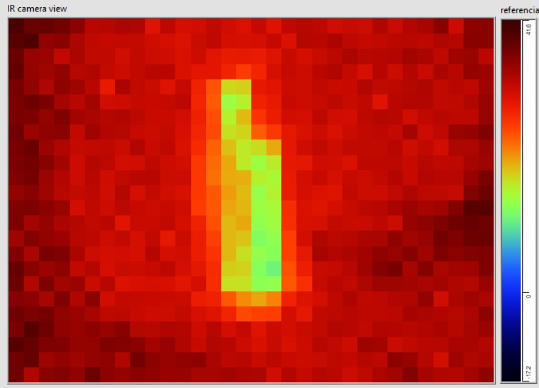
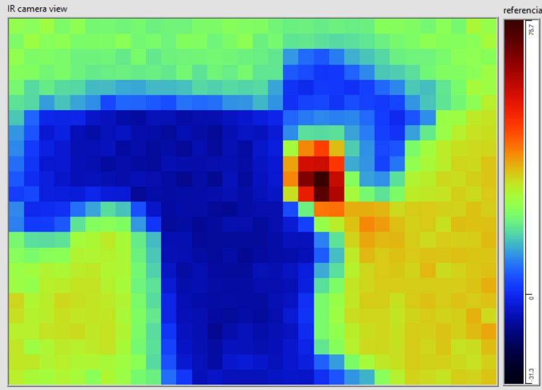

[← Volver al portfolio](../portfolio)

# Cámara térmica con MLX90640 y NI myRIO

Proyecto personal.  
Sensor infrarrojo Melexis MLX90640 por I2C, procesamiento en LabVIEW Real-Time sobre NI myRIO.

<video src="../assets/img/camara-termica-myrio/persona-saludando.mp4" autoplay loop muted playsinline width="480"></video>

## Resumen

Armé una cámara térmica con el MLX90640, una matriz de 32 × 24 termopilas, conectada a la myRIO por I2C. El programa lee los cuadros crudos del sensor, los convierte a temperatura y los muestra en el panel de LabVIEW con una paleta de color.

El MLX90640 no entrega temperaturas directamente. Cada píxel necesita sus propios coeficientes de calibración, que vienen guardados en la EEPROM del sensor. Melexis publica ese cálculo como una librería en C pensada para microcontroladores. LabVIEW no puede usarla tal cual en la myRIO, así que la traduje entera a LabVIEW, función por función. Esa traducción es la mayor parte del trabajo.

## Cómo funciona

1. Al arrancar, el programa lee la EEPROM y extrae los parámetros de calibración: tensión de alimentación (Vdd), temperatura ambiente del sensor (Ta), ganancia, offset y sensibilidad (alfa) de cada píxel, los coeficientes Kta y Kv, y la lista de píxeles defectuosos.
2. En cada cuadro lee las dos subpáginas del sensor y compensa los datos IR por ganancia, por Vdd y Ta, y por el píxel de compensación (CP).
3. Con la sensibilidad corregida calcula la temperatura de objeto (To) de cada píxel. Los píxeles marcados como defectuosos se reemplazan.
4. La matriz de temperaturas se pinta con una paleta de color que diseñé a partir de curvas gaussianas para los canales R, G y B, con una barra de referencia.

Cada función de la librería original quedó como un subVI separado (DEVICE START, FRAME READ, VddCalc, TaCalc, IRdataCompensation, ToCalc, BrokenPixels...). Así cada etapa se puede probar sola contra los valores del datasheet.

## Pruebas

Probé la cámara con objetos fríos y calientes contra fondos distintos: la llama de un encendedor, cubitos de hielo, carne congelada, una botella fría, una mano y una persona saludando frente al sensor.

<video src="../assets/img/camara-termica-myrio/llama-encendedor.mp4" autoplay loop muted playsinline width="480"></video>

<video src="../assets/img/camara-termica-myrio/cubitos-hielo.mp4" autoplay loop muted playsinline width="480"></video>

| | |
|---|---|
|  |  |
| Mano sobre fondo nocturno | Cubitos de hielo |
|  |  |
| Botella fría | Llama en la noche |

Con 768 píxeles la imagen es gruesa, pero alcanza para distinguir siluetas, gradientes de temperatura y puntos calientes. Para una imagen más fina habría que interpolar la matriz antes de pintarla, y eso queda para una versión siguiente.

## Herramientas

LabVIEW Real-Time · NI myRIO · I2C · Melexis MLX90640
