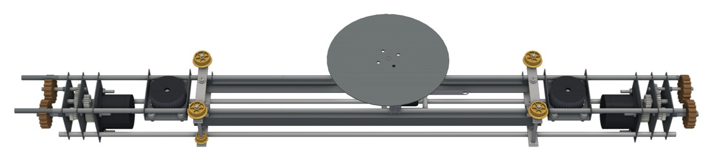
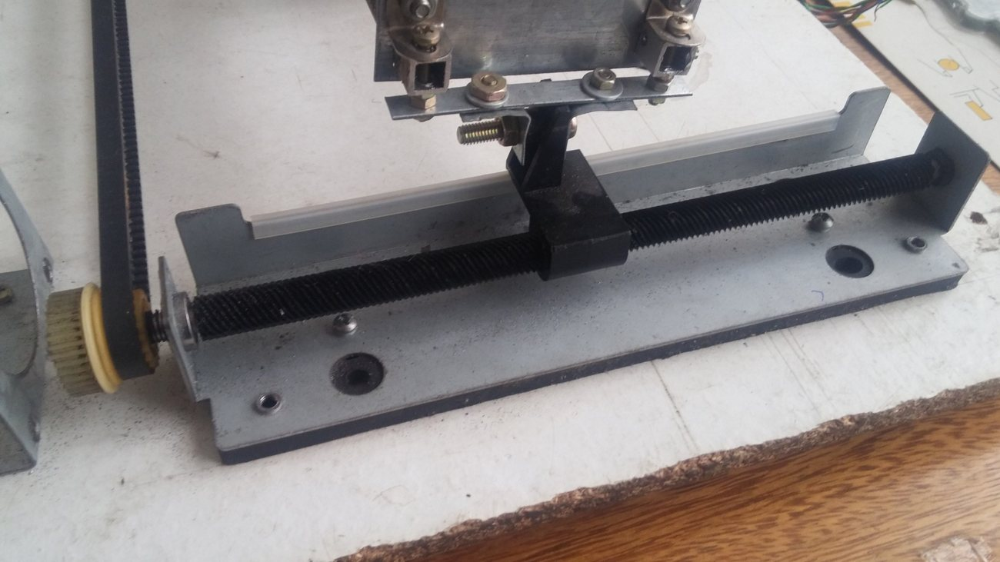
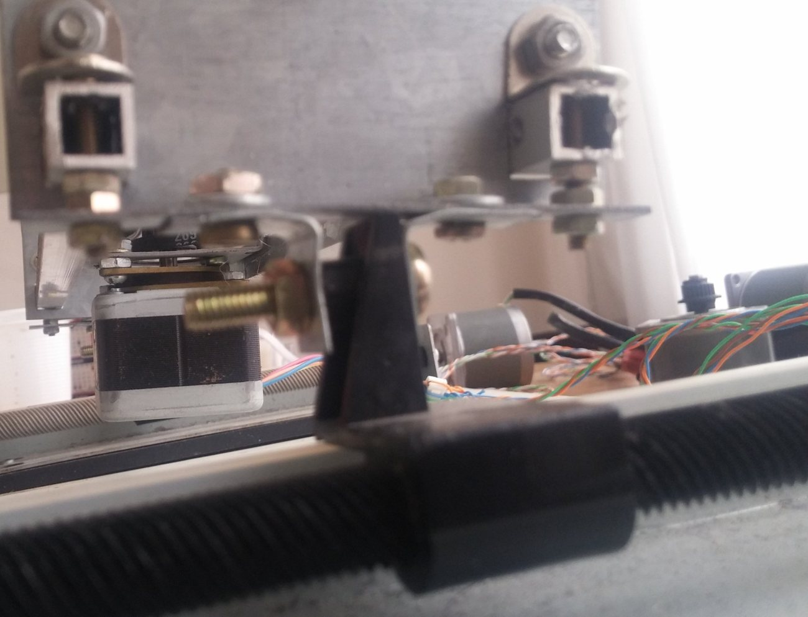
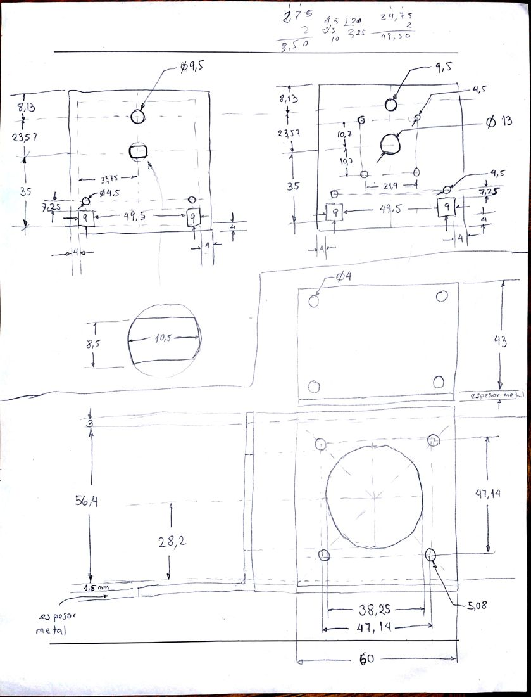
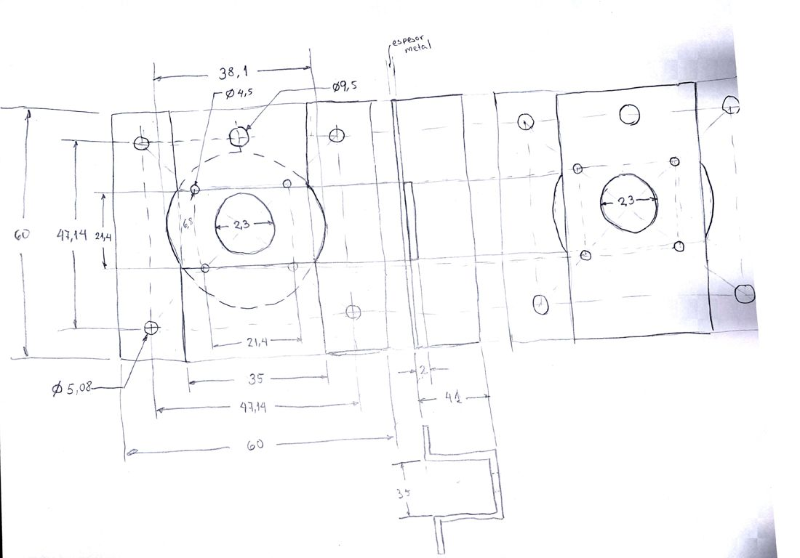
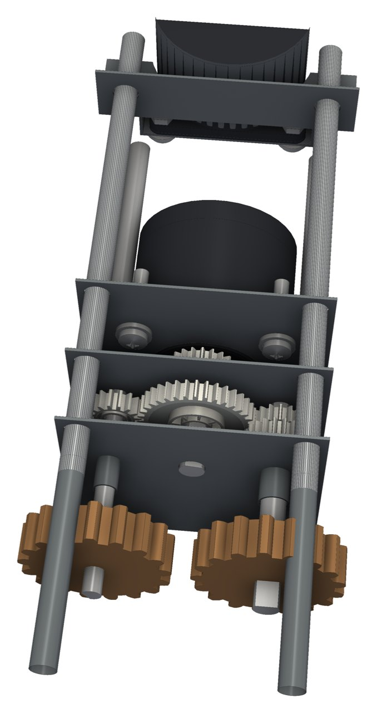
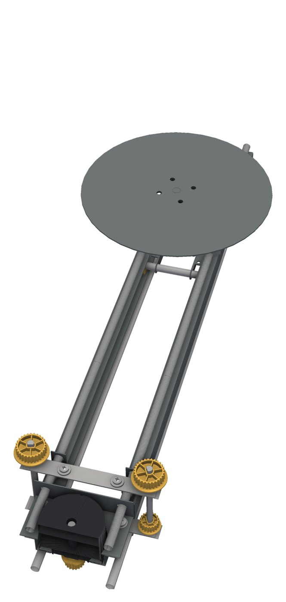

[← Volver al portfolio](../portfolio)

# Máquina de 3 ejes para un escaparate

Sistema de posicionamiento con motores paso a paso para una vitrina de muñecos de peluche.  
Tres versiones: PIC16F877A en C, Arduino con drivers STEP/DIR y un rediseño mecánico completo en Solid Edge.

{: width="900"}

## El problema

La máquina tenía que mover un muñeco dentro de un escaparate: ubicarlo en el plano, girarlo y sacarlo de su posición siguiendo una secuencia fija. Las dos primeras versiones funcionaron. La tercera fue un rediseño mecánico que quedó en el modelo 3D y no llegó a probarse.

## Versión 1: PIC16F877A en C

Tres motores paso a paso unipolares, dos para los ejes X e Y y un tercero de giro con pasos de 7,5°. Cada motor se maneja con cuatro líneas de un puerto del PIC. El firmware, en C con el compilador CCS, genera la secuencia de fases rotando un patrón de bits.

La parte interesante es `go_to(x, y)`, que lleva el cabezal de un punto a otro **en línea recta** sobre un área de 920 × 1290 pasos. Avanza un paso en el eje que más recorre y calcula cuánto le toca al otro con la pendiente, redondeando al paso entero más cercano. Antes de grabar el PIC comprobé el algoritmo en una planilla y simulé los motores en Proteus.

```c
if (abs(delta_x) >= abs(delta_y))
{
   if (delta_x > 0) i = +incremen;
   else             i = -incremen;

   m = (delta_y*1.0)/(delta_x*1.0);
   while (x0 < xf || x0 > xf)
   {
      x1 = x0 + i;
      fl_y = m*(i*1.0) + fl_y;
      y1 = round(fl_y);
      j = y1 - y0;
      ...
      mov_mot(Mx, dx, abs(i));
      mov_mot(My, dy, abs(j));
      x0 = x1;
      y0 = y1;
   }
}
```

La secuencia de trabajo combina movimientos `go_to()` con giros del tercer motor, y un pulsador la inicia y la reanuda.

La mecánica de esta versión aprovechó piezas recicladas: un tornillo con su tuerca guía y rieles de equipos viejos, poleas y correas dentadas, y chapa de aluminio para el carro.

| | |
|---|---|
|  |  |
| Eje con tornillo, tuerca guía y correa | Motor paso a paso sobre el carro |

## Versión 2: Arduino con drivers STEP/DIR

Pasé a motores con drivers STEP/DIR y simulé en Proteus un driver con *chopper* de corriente (L297). Antes de escribir el control probé por separado cómo generar los pulsos: con temporizador, con PWM y con el L297. El sketch principal mueve los tres motores con la librería AccelStepper: un Timer1 lee cada 10 ms tres potenciómetros por el ADC y los convierte en velocidad y sentido de cada motor. Para los movimientos coordinados partí del ejemplo MultiStepper de la misma librería.

Las piezas de esta versión las dibujé primero a mano con sus cotas y después las pasé a Solid Edge y AutoCAD.

| | |
|---|---|
|  |  |
| Bocetos acotados de las piezas | Soportes de motor |

## Versión 3: rediseño mecánico en Solid Edge

Para la tercera versión rehíce toda la mecánica en Solid Edge. Son unos 1,7 m de largo, con tornillos y guías de 1 m. En cada extremo va un módulo de tracción: motor, tren de engranajes entre placas y ruedas de salida. Sobre el carro central va un tercer motor con transmisión por correa y la plataforma circular que sostiene el muñeco. El ensamble tiene 46 piezas distintas diseñadas por mí, además de la tornillería normalizada, y exporté los planos de las placas a AutoCAD.

| | |
|---|---|
|  |  |
| Módulo de tracción: motor, reductora y ruedas | Carro con el tercer motor y la plataforma |

Este diseño no se fabricó ni se probó.

## Qué mejoraría

- **Velocidad y suavidad (v1).** Cada paso espera 44 ms con `delay_ms()`, así que el motor no pasa de unos 22 pasos/s y la CPU no hace nada más mientras tanto. Con un timer por interrupción y rampas de aceleración se podría ir más rápido sin perder pasos.
- **Interpolación sin punto flotante (v1).** El PIC16 no tiene FPU y cada `float` cuesta caro. El algoritmo de Bresenham hace lo mismo solo con sumas de enteros.
- **Trabajo dentro de la interrupción (v2).** El sketch lee el ADC dentro de la ISR del Timer1. Lo correcto es que la ISR solo marque una bandera y que la lectura se haga en el lazo principal.
- **Secuencia fija.** El recorrido está escrito en el código. Recibirlo como lista de puntos por el puerto serie (o en G-code) permitiría cambiarlo sin reprogramar.

## Herramientas

PIC16F877A · C (CCS) · Arduino · AccelStepper · L297 · Proteus · Solid Edge · AutoCAD
