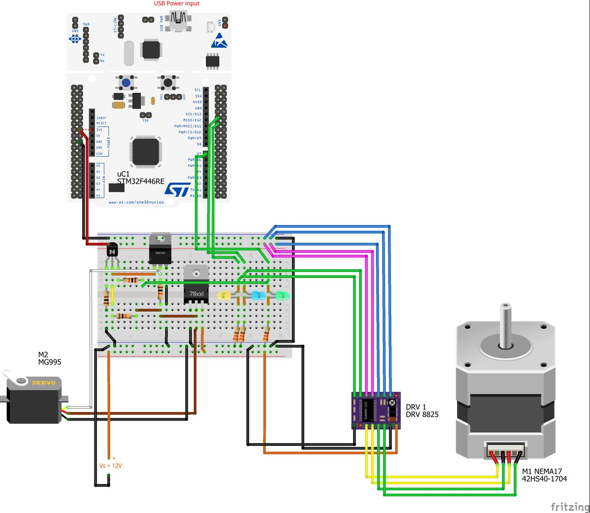
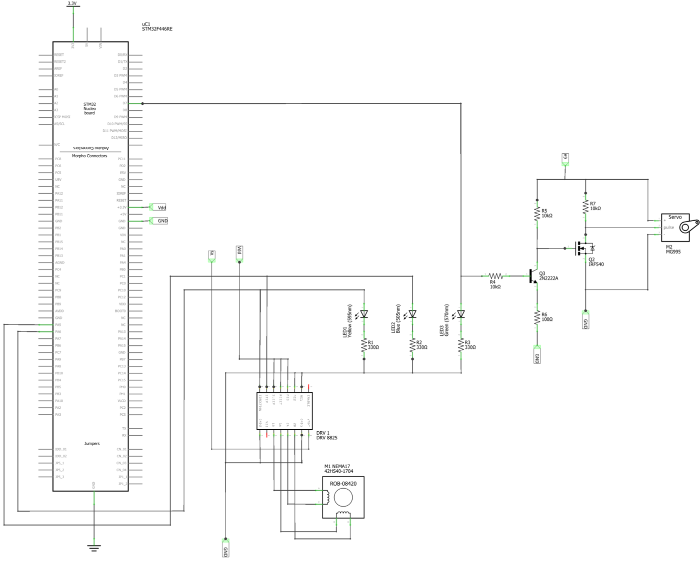

[← Volver al portfolio](../portfolio)

# Control de motores con STM32 (stepper y servo)

Trabajo para un cliente: el control de movimiento de un proyector motorizado.  
Firmware en C con HAL sobre un STM32F446RE (Nucleo-64), configurado en STM32CubeMX y desarrollado en Keil µVision.

{: width="680"}

## El problema

El proyector necesitaba girar sobre su eje y mover el lente. Con el cliente definimos la mecánica: un motor paso a paso para la rotación principal y servomotores para el lente y el sensor. Mi parte fue elegir motores y drivers, diseñar la electrónica de potencia, escribir el firmware y dejar todo documentado para que el equipo del cliente pudiera replicarlo.

## Hardware

- **Stepper:** NEMA 17 42HS40-1704, bipolar, 1,7 A por fase y 200 pasos por vuelta, con un driver DRV8825. Ajusté la corriente del driver con VREF (VREF = I/2) y dejé previsto el microstepping con los pines MODE.
- **Servo:** MG995, que pide entre 4,8 y 7,2 V tanto en la alimentación como en la señal. Lo alimenté a 6 V con un LM7806 y diseñé un adaptador de nivel de dos etapas (2N2222 + IRF540) que lleva el PWM de 3,3 V del STM32 a 6 V y aísla el pin del ruido del motor.
- **Alimentación:** una sola fuente de 12 V para el DRV8825 y el regulador. Antes de armar, simulé las fuentes en Multisim.
- **Diagnóstico:** tres LED muestran la dirección del stepper, su velocidad (por la frecuencia de parpadeo) y el PWM del servo (por la intensidad).

{: width="760"}

## Firmware

El STM32 corre a 180 MHz. Usé tres periféricos:

- **TIM2 (32 bits) con interrupción** genera los pulsos STEP del DRV8825. Cada interrupción conmuta el pin STEP y el período del timer define la velocidad. Por encima de un umbral el motor se detiene. El pin DIR se fija según el signo de la velocidad recibida.
- **TIM1 en modo PWM** genera la señal de 50 Hz del servo, con resolución de 16 bits en el registro de comparación.
- **USART2 a 115200 baudios**, por el mismo USB del ST-LINK, recibe comandos de la PC con un protocolo binario de 4 bytes:

| Byte 0 | Bytes 1-3 | Acción |
|---|---|---|
| `0xFF` | velocidad del stepper, 24 bits con signo | el signo fija DIR y el valor el período de STEP |
| `0x00` | byte 1 libre; bytes 2-3: PWM de 16 bits | posición del servo |

La recepción funciona por interrupción. Este es el *callback* que decodifica la trama, tal como quedó en el prototipo:

```c
void HAL_UART_RxCpltCallback(UART_HandleTypeDef *huart)
{
  if (UART1_rxBuffer[0] == 0xFF)
	{
		signo = (UART1_rxBuffer[1] & 0x80) ? -1 : 0;
		if ( signo == 0)
			timerVal = 0x00 << 24 | UART1_rxBuffer[1] << 16 | UART1_rxBuffer[2] << 8 | UART1_rxBuffer[3];
		else
		{
			timerVal = 0xFF << 24 | UART1_rxBuffer[1] << 16 | UART1_rxBuffer[2] << 8 | UART1_rxBuffer[3];
			timerVal = -timerVal;
		}
	}
	else if (UART1_rxBuffer[0] == 0x00)
	{
		pwmVal = (UART1_rxBuffer[2] << 8) | UART1_rxBuffer[3];
	}
	HAL_UART_Receive_IT(&huart2, UART1_rxBuffer, UART1_blockSize);
}
```

Hubo dos versiones del firmware. En la primera, dos potenciómetros leídos por el ADC fijaban la velocidad del stepper y la posición del servo. En la segunda reemplacé los potenciómetros por el puerto serie, para mandar los valores desde la PC. Entregué un informe con la configuración de CubeMX paso a paso, el esquema y el código, para que el cliente pudiera reproducir el prototipo.

## Qué mejoraría

Revisando el código con más experiencia, cambiaría cuatro cosas:

1. **Jitter en los pasos.** El lazo principal detiene y vuelve a arrancar el TIM2 en cada interrupción para recargar el período. Eso agrega jitter y no hace falta: basta con habilitar el *preload* del ARR y escribirlo solo cuando llega una velocidad nueva.
2. **Pasos por hardware.** Hoy el pin STEP lo conmuta la CPU dentro de la ISR. Con un canal del timer en modo *output compare toggle* o PWM, los pulsos salen por hardware sin jitter de software, y se pueden agregar rampas de aceleración para que el motor no pierda pasos al arrancar.
3. **Protocolo más robusto.** La trama de 4 bytes no tiene checksum ni forma de resincronizarse si se pierde un byte. Agregaría un byte de inicio, un CRC y un *timeout* de recepción.
4. **Unidades en el firmware.** La PC manda períodos de timer y valores crudos de PWM. Sería más claro mandar pasos/s y grados, y que el firmware haga la conversión y aplique límites.

## Extra: driver propio para pantalla TFT ST7789

En otro proyecto con el mismo STM32F446RE escribí desde cero un driver para una pantalla TFT ST7789 de 240 × 240 por SPI a 45 Mbit/s. Tiene inicialización, ventana de dirección, píxeles, líneas, rectángulos, círculos y sectores circulares, conversión de RGB888 a RGB565 y envío de imágenes completas por DMA en bloques.

Lo que mejoraría ahí: el envío por DMA espera a que termine cada bloque de 256 bytes, así que en la práctica sigue siendo bloqueante. Usaría bloques más grandes con el *callback* de fin de transferencia. Además, configurar el SPI en 16 bits evitaría invertir los bytes de cada píxel por software, y dibujar por franjas en vez de usar un *frame buffer* completo (115 KB de los 128 KB de RAM del F446) dejaría memoria libre para el resto de la aplicación.

## Herramientas

STM32F446RE (Nucleo-64) · C con HAL · STM32CubeMX · Keil µVision · DRV8825 · Multisim · Fritzing
