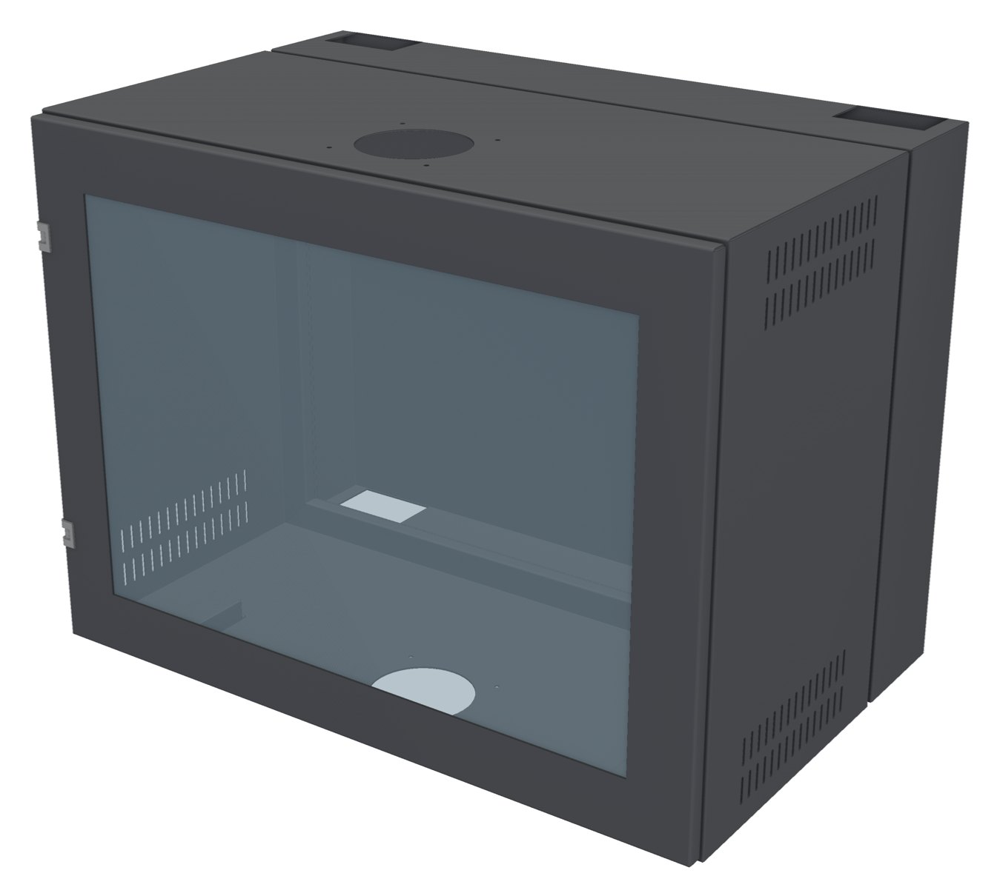
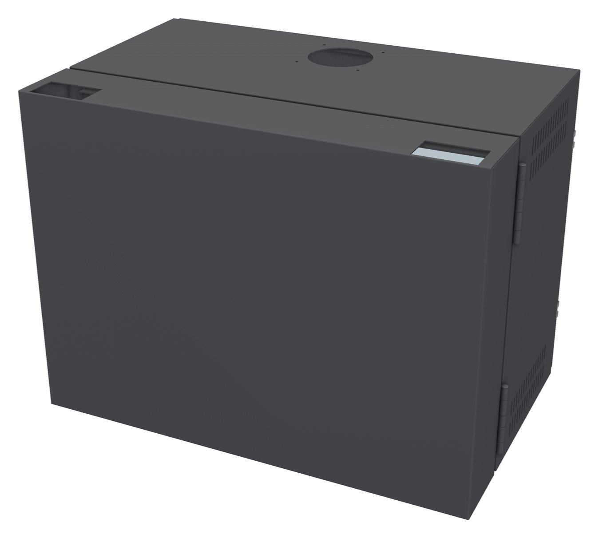
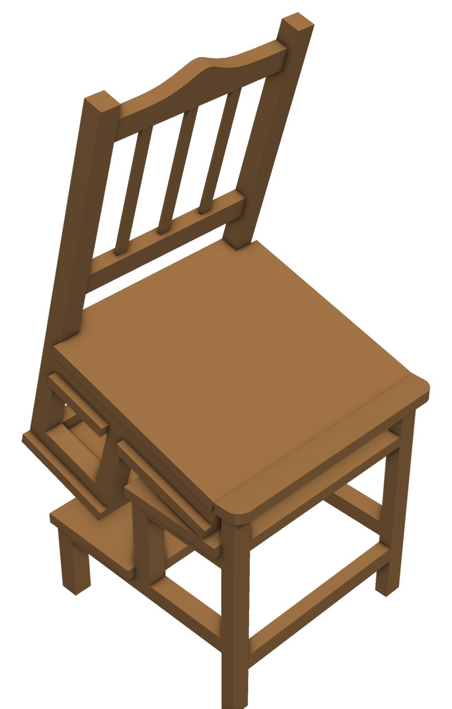
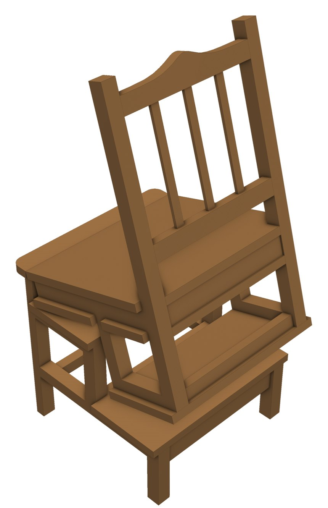

[← Volver al portfolio](../portfolio)

# Diseño mecánico en CAD 3D

Dos modelos en Solid Edge: un gabinete de telecomunicaciones en chapa metálica y una silla que se convierte en escalera. El colector solar del [proyecto de grado](seguidor-solar-myrio) también está modelado en Solid Edge.

## Gabinete de telecomunicaciones para montaje en pared

Modelé un rack de pared a partir de un gabinete que ya estaba fabricado, copiando pieza por pieza. El ensamble mide 811 × 515 × 600 mm.

Todas las piezas de chapa están hechas con el módulo de chapa metálica de Solid Edge: el cuerpo central, la pared trasera que va fijada al muro, la puerta y el soporte del rack. El cuerpo central lleva el soporte soldado y se une a la pared trasera con bisagras, así que se abre para trabajar por detrás de los equipos. Al frente va una puerta con ventana sobre sus propias bisagras. Tiene ranuras de ventilación a los lados y en el techo, y pasacables arriba y abajo.

Del conjunto de bisagras traseras hice un plano con cotas: bisagra A, bisagra B y pasador.

{: width="520"}

{: width="520"}

## Silla escalera

Una silla de madera que se convierte en escalera. Partí de un diseño de silla-escalera que ya existe y lo modelé pensando en que la usaran mis padres. El ensamble mide 450 × 510 × 994 mm y está dividido en dos subensambles, superior e inferior.

No se llegó a fabricar. Al revisar el modelo vi que, según cómo se suba una persona, la carga puede quedar fuera de la base de apoyo y la escalera se vuelca. Para personas mayores ese riesgo no era aceptable, y corregirlo exigía cambiar la geometría de la base. Preferí parar en el modelo antes que construir algo inseguro.

{: width="380"}

{: width="380"}

## Herramientas

Solid Edge (piezas, chapa metálica, ensambles y planos)
