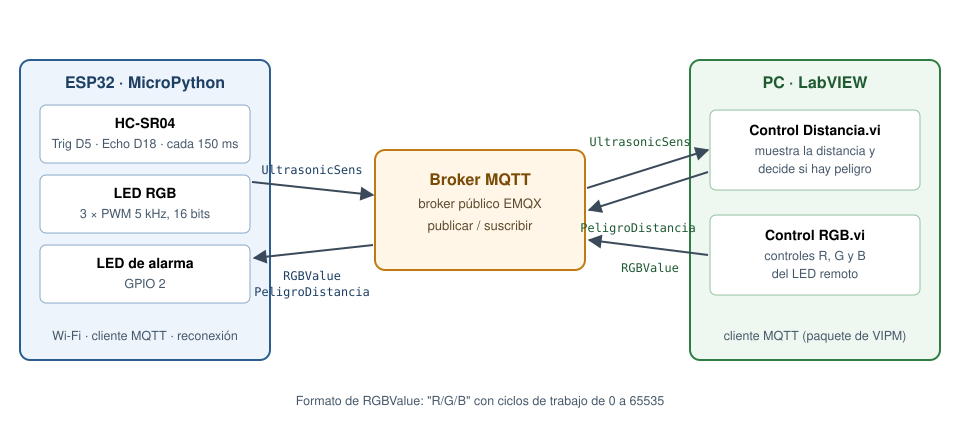

[← Volver al portfolio](../portfolio)

# Domótica IoT con ESP32, MQTT y LabVIEW

Proyecto personal, hecho durante el curso de IoT con MicroPython de Cisco.  
ESP32 con MicroPython, broker MQTT público y paneles de control en LabVIEW. Probado varias veces de punta a punta.



## Qué hace

Es una simulación de un sistema domótico. Un ESP32 mide distancia con un sensor ultrasónico HC-SR04 y la publica por MQTT. En la PC, un programa en LabVIEW recibe la distancia, decide si hay peligro y le responde al ESP32, que enciende un LED de alarma. Un segundo panel de LabVIEW controla a distancia el color de un LED RGB conectado al ESP32.

Los dos lados nunca se hablan directamente: cada uno publica y se suscribe a *topics* en un broker MQTT público. Así, cualquier otro cliente puede leer el sensor o mandar órdenes sin tocar el firmware.

| Topic | Publica | Se suscribe | Contenido |
|---|---|---|---|
| `UltrasonicSens` | ESP32 | LabVIEW | distancia en cm, cada 150 ms |
| `PeligroDistancia` | LabVIEW | ESP32 | `1` o `0` para el LED de alarma |
| `RGBValue` | LabVIEW | ESP32 | `"R/G/B"`, ciclos de trabajo de 0 a 65535 |

## Firmware del ESP32 (MicroPython)

El ESP32 se conecta al Wi-Fi como estación, se registra en el broker con un ID derivado de su dirección única y se suscribe a los dos topics de entrada. En el lazo principal revisa si llegaron mensajes, mide la distancia y la publica. Los tres canales del LED RGB son PWM de 5 kHz con resolución de 16 bits. Si se pierde la conexión con el broker, el ESP32 espera 10 s y se reinicia para volver a conectarse solo.

El *callback* que atiende los mensajes entrantes:

```python
def sub_cb(topic, msg):
    print((topic, msg))
    if topic == b'RGBValue':
        RGBduty = msg.decode()
        RGBduty = [int(d) for d in RGBduty.split('/')]
        pwmRED.duty_u16(RGBduty[0])
        pwmGREEN.duty_u16(RGBduty[1])
        pwmBLUE.duty_u16(RGBduty[2])
    if topic == b'PeligroDistancia':
        led.value(int(msg))
```

Para el sensor usé la librería HC-SR04 de Roberto Sánchez y para MQTT el cliente `umqttsimple`.

## Paneles en LabVIEW

Del lado de la PC hay dos VIs con el cliente MQTT que se instala con VI Package Manager:

- **Control Distancia:** se suscribe a la distancia, la muestra, la compara con un umbral y publica el estado de peligro.
- **Control RGB:** tres controles (R, G y B) que arman el mensaje `"R/G/B"` y lo publican cuando cambian.

Antes de integrar todo hice dos pruebas funcionales: primero el ESP32 con el sensor solo, y después el sensor publicando por MQTT hacia LabVIEW.

## El mismo sensor, otras vías

Con el mismo ESP32 y el mismo HC-SR04 probé otras formas de sacar los datos:

- **Servidor web en el ESP32:** una página HTML servida por *socket* que muestra la lectura.
- **Bluetooth Low Energy:** un UART sobre BLE para mandar y recibir texto desde una app del celular.
- **REST con ThingSpeak:** el ESP32 lee de un canal en la nube los datos de un motor (carga y temperatura) y enciende una alarma si la temperatura pasa de 70 °C.

## Qué mejoraría

- **Seguridad:** el broker es público y sin TLS ni usuario, y las credenciales del Wi-Fi están escritas en el código. Para algo real usaría un broker propio con TLS y autenticación, y guardaría las credenciales en un archivo de configuración fuera del repositorio.
- **Formato de mensajes:** pasaría a JSON con nombres de campo, en lugar de texto separado por `/`, y validaría los datos antes de aplicarlos.
- **Reconexión:** reiniciar todo el ESP32 cuando falla la conexión funciona, pero es brusco. Es mejor reintentar con espera creciente y usar el *Last Will* de MQTT para que el panel sepa que el equipo se desconectó.
- **Frecuencia y QoS:** publicar cada 150 ms está bien para una prueba. En uso real publicaría solo cuando la distancia cambie más que un umbral, y elegiría el QoS según el topic.

## Herramientas

ESP32 · MicroPython · Thonny · MQTT · LabVIEW · HC-SR04 · BLE · ThingSpeak
