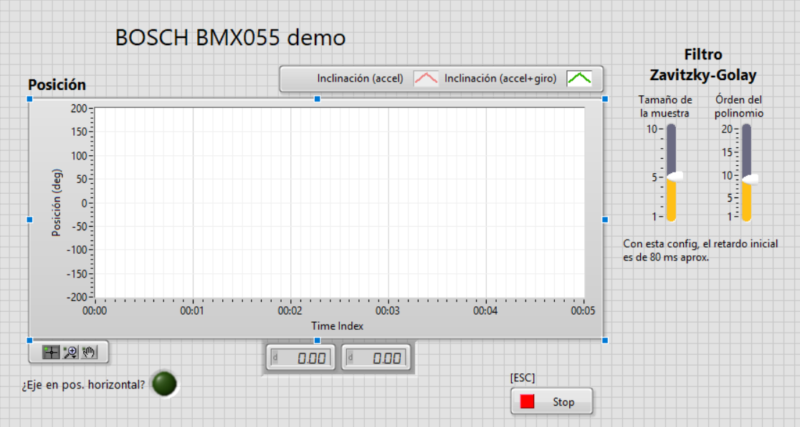

[← Volver al portfolio](../portfolio)

# Instrumentación y adquisición de datos con LabVIEW y myRIO

Drivers de sensores, medición en FPGA y procesamiento de señales en LabVIEW sobre NI myRIO.  
Varias de estas piezas terminaron dentro del [colector solar con seguimiento](seguidor-solar-myrio).

{: width="760"}

## Inclinómetro con BMX055

El BMX055 de Bosch tiene acelerómetro, giróscopo y magnetómetro en un solo encapsulado. Lo conecté a la myRIO por I2C y armé en LabVIEW la cadena completa: lectura de los datos crudos por I2C y conversión a unidades físicas, con un sub-VI que pasa el acelerómetro a *g* y otro que pasa el giróscopo a °/s.

Con esos datos calculo la inclinación de dos maneras y las grafico juntas:

- solo con el acelerómetro, que es exacta en reposo pero ruidosa cuando hay vibración;
- combinando acelerómetro y giróscopo, que responde mejor al movimiento.

Encima de eso apliqué un filtro de Savitzky-Golay con el tamaño de ventana y el orden del polinomio ajustables desde el panel. Este filtro suaviza la señal sin aplanar los cambios rápidos como lo haría un promedio móvil. Con la configuración por defecto el retardo inicial es de unos 80 ms. Un indicador muestra si el eje está en posición horizontal.

El proyecto pasó por cuatro versiones: una primera lectura del módulo, una de calibración, el inclinómetro y el inclinómetro avanzado con fusión y filtro. Hice lo mismo con un MPU6050, escribiendo mi propio driver en lugar de usar el demo de NI. El BMX055 en rango de ±2 *g* fue el que quedó como sensor de inclinación del colector solar.

## Tacómetro en la FPGA

Para medir la velocidad de motores con encoder adapté a la myRIO un ejemplo de tacómetro de NI pensado para CompactRIO. La FPGA cuenta el tiempo entre flancos del encoder con un reloj de 40 MHz y filtra con histéresis los falsos disparos, y el procesador de tiempo real convierte el período en RPM. Con esto obtuve las curvas de velocidad que usé para identificar los parámetros del motor DC del colector.

## Reloj sincronizado con NIST

El seguimiento solar necesita la hora exacta para calcular la posición del sol. Hice un VI que sincroniza el reloj del procesador de tiempo real de la myRIO con los servidores de hora del NIST cuando hay conexión a internet.

## Enseñanza

Dicto cursos de introducción a LabVIEW para profesionales y estudiantes de ingeniería: diagramas de bloques y panel frontal, tipos de datos y estructuras, módulos de procesamiento de señales, control y SCADA, y adquisición de datos con hardware externo (Arduino por puerto serie). También dicto cursos de MATLAB y Simulink.

## Herramientas

LabVIEW (RT y FPGA) · NI myRIO · I2C · Bosch BMX055 · MPU6050 · encoders incrementales
