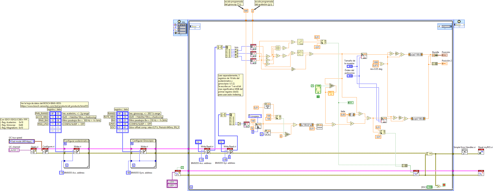

[← Volver al portfolio](../portfolio)

# Instrumentación y adquisición de datos con LabVIEW y myRIO

Drivers de sensores, medición en FPGA y procesamiento de señales en LabVIEW sobre NI myRIO.  
Varias de estas piezas terminaron dentro del [colector solar con seguimiento](seguidor-solar-myrio).

{: width="760"}

## Inclinómetro con BMX055

El BMX055 de Bosch tiene acelerómetro, giróscopo y magnetómetro en un solo encapsulado. Lo conecté a la myRIO por I2C en modo rápido (400 kbit/s) y escribí el driver en LabVIEW a partir de la hoja de datos, sin librerías de terceros.

**Configuración.** Al arrancar, el programa escribe los registros de cada sensor:

| Sensor | Dirección I2C | Rango | Filtro | Otros |
|---|---|---|---|---|
| Acelerómetro | `0x18` | ±2 *g* | pasa bajos de 500 Hz | modo normal, *shadowing* activo |
| Giróscopo | `0x68` | ±500 °/s | pasa bajos de 230 Hz | compensación lenta de *offset* en el eje X |

**Lectura.** Un lazo temporizado corre cada 10 ms (100 Hz). En cada ciclo lee en una sola transacción los tres ejes de 16 bits de cada sensor y los pasa a *g* y a °/s según la escala programada.

**Cálculo de la inclinación.** La inclinación sale por dos caminos que se grafican juntos:

- Solo con el acelerómetro, a partir de la dirección de la gravedad con funciones trigonométricas. Es exacta en reposo, pero ruidosa con vibración.
- Con un **filtro complementario**: integro la velocidad angular del giróscopo, previamente filtrada con un pasa bajos, y la combino con el ángulo del acelerómetro con un peso β = 0,85. El giróscopo aporta respuesta rápida y el acelerómetro corrige la deriva de la integral.

A cada salida le aplico un filtro de Savitzky-Golay con el tamaño de ventana y el orden del polinomio ajustables desde el panel. Suaviza la señal sin aplanar los cambios rápidos como lo haría un promedio móvil. Con la configuración por defecto el retardo inicial es de unos 80 ms. Cuando la inclinación queda dentro de ±0,01 rad, el programa enciende un LED de la myRIO y un indicador en el panel para avisar que el eje está horizontal.

El proyecto pasó por cuatro versiones: una primera lectura del módulo, una de calibración, el inclinómetro y el inclinómetro avanzado con fusión y filtro. El BMX055 fue el que quedó como sensor de inclinación del colector solar.

## Tacómetro en la FPGA

Para medir la velocidad de motores con encoder adapté a la myRIO un ejemplo de tacómetro de NI pensado para CompactRIO. La FPGA cuenta el tiempo entre flancos del encoder con un reloj de 40 MHz y filtra con histéresis los falsos disparos, y el procesador de tiempo real convierte el período en RPM. La velocidad de la FPGA permite medir con buena resolución incluso movimientos pequeños del motor. Con esto obtuve las curvas de velocidad que usé para identificar los parámetros del motor DC del colector.

## Reloj sincronizado con NIST

El seguimiento solar necesita la hora exacta para calcular la posición del sol. Hice un VI que sincroniza el reloj del procesador de tiempo real de la myRIO con los servidores de hora del NIST cuando hay conexión a internet.

## Enseñanza

Dicto cursos de introducción a LabVIEW para profesionales y estudiantes de ingeniería: diagramas de bloques y panel frontal, tipos de datos y estructuras, módulos de procesamiento de señales, control y SCADA, y adquisición de datos con hardware externo (Arduino por puerto serie). También dicto cursos de MATLAB y Simulink.

## Herramientas

LabVIEW (RT y FPGA) · NI myRIO · I2C · Bosch BMX055 · encoders incrementales
