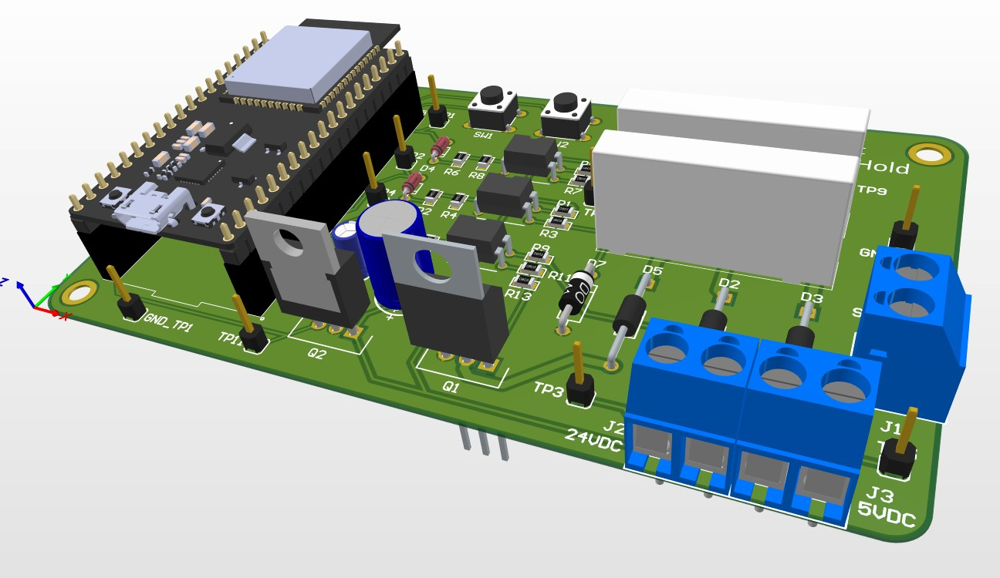
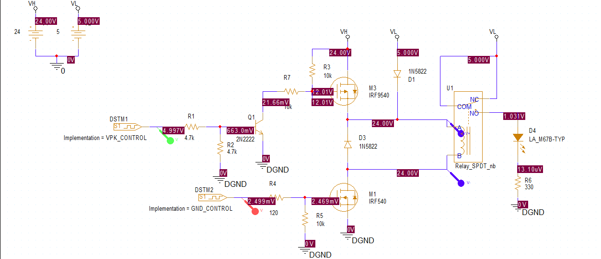
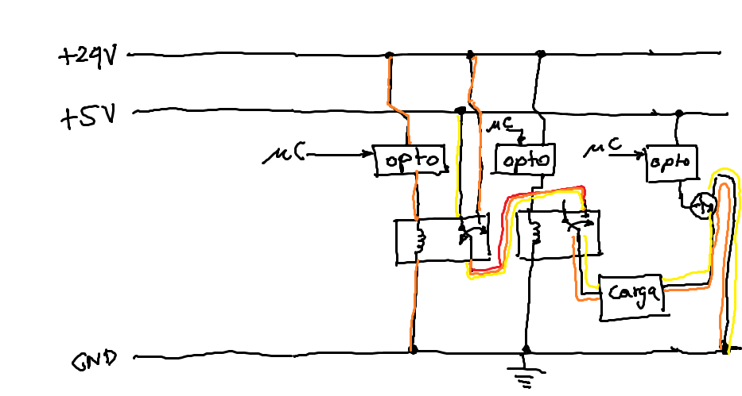
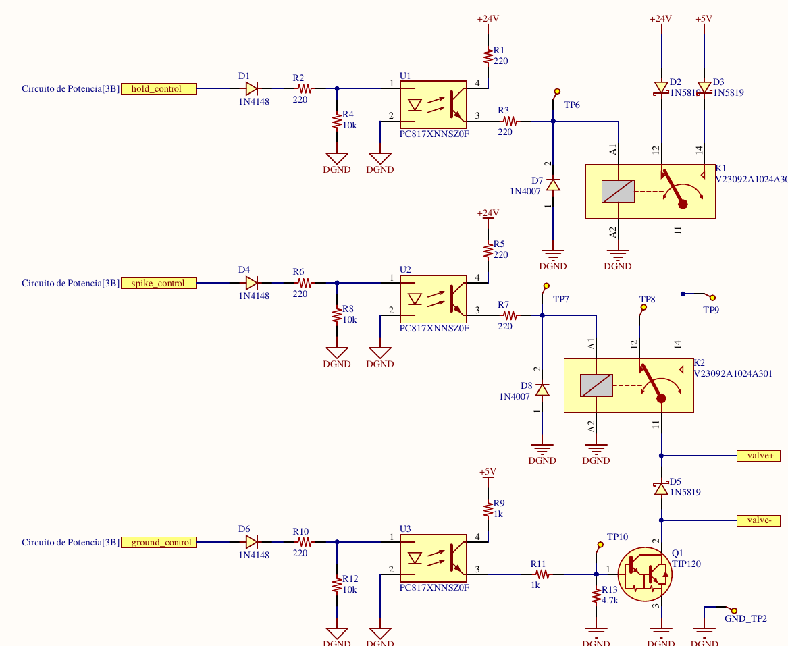
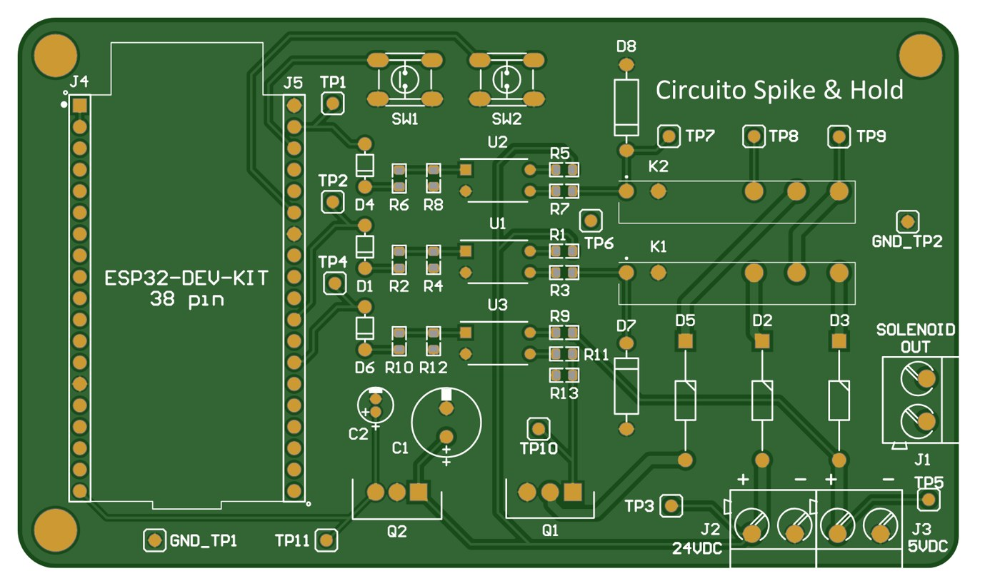
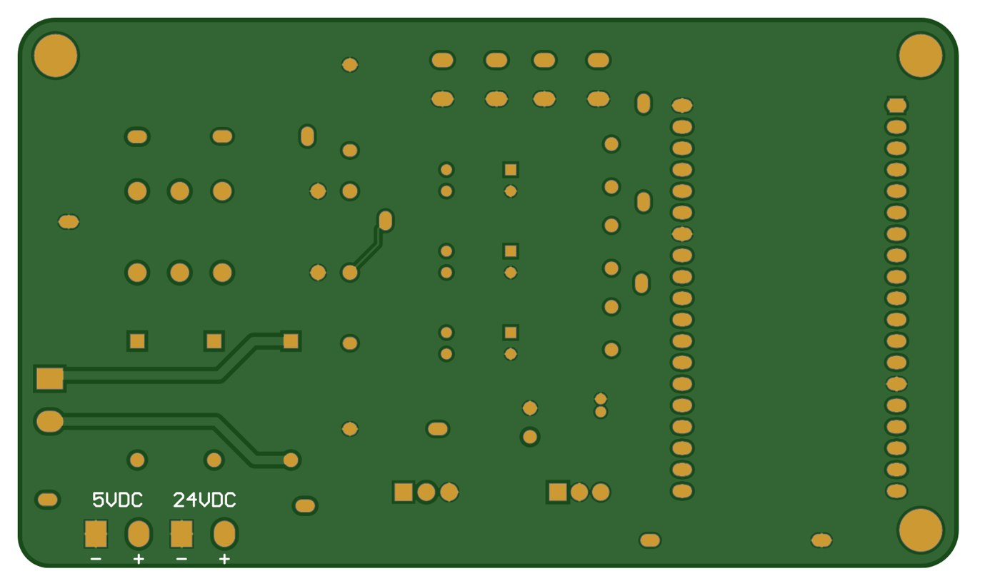
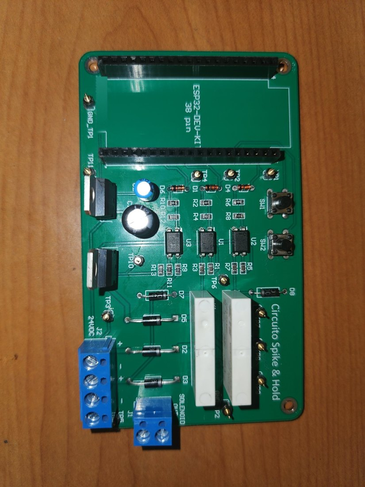

[← Volver al portfolio](../portfolio)

# PCB de activación de válvulas solenoide (Spike & Hold + ESP32)

Trabajo para un cliente. Placa fabricada y probada.  
Diseño del circuito y de la placa en Altium Designer, con control desde un ESP32.

{: width="760"}

## El problema

Las válvulas de tinta de una etiquetadora industrial son solenoides de 24 V. Cada una necesita un pulso corto a 24 V para abrir (unos 13 ms, según el fabricante) y después solo entre 3 y 5 V para quedarse abierta. Es la técnica *spike & hold*: el pico de corriente vence la inercia del núcleo y el voltaje bajo de mantenimiento reduce el calentamiento y el consumo de la bobina. Cuando el voltaje desaparece, el núcleo vuelve y la válvula se cierra.

## Primera versión

La primera versión usaba un PIC12F629 programado en C con dos pulsadores, MOSFET IRF540 e IRF9540 para conmutar entre 24 V y 5 V, y un regulador 7805 para la lógica. Antes de armarla en protoboard la simulé en Multisim, Proteus y PSpice, con una variante a transistores bipolares y otra con MOSFET.

{: width="720"}

## Segunda versión: del boceto a la placa

Para la segunda versión empecé con un boceto a mano de la idea: tres señales del microcontrolador, cada una aislada con un optoacoplador, que manejan dos relés y un transistor.

{: width="560"}

El circuito final funciona así:

- **Enclavamiento y mantenimiento (K1).** Para abrir la válvula, K1 le aplica primero 24 V. Unos milisegundos después conmuta al riel de 5 V, y la válvula se queda así, con menos consumo, hasta que haya que cambiar su estado. Los Schottky 1N5819 evitan que un riel se alimente desde el otro.
- **Apagado (K2).** El segundo relé desactiva todo abriendo el lazo de retorno a tierra de la válvula.
- **Lado bajo y protección.** Un Darlington TIP120 conmuta el lado bajo de la válvula. Un Schottky en paralelo con la bobina descarga su energía al apagar.
- **Aislamiento.** Las tres entradas pasan por optoacopladores PC817, así el ESP32 queda aislado del lado de 24 V. Las bobinas de los relés llevan su diodo 1N4007.
- **Alimentación y pruebas.** Un LM7805 baja los 24 V a 5 V para la lógica. La placa tiene entradas separadas de 24 VDC y 5 VDC, dos pulsadores de mando local y 13 puntos de prueba para medir cada etapa.

{: width="760"}

## La placa

La placa es de dos capas y mide 111 × 65 mm. El ESP32-DevKitC de 38 pines va enchufado en dos tiras hembra, así se cambia sin desoldar. Mezcla componentes de inserción (relés, TO-220, borneras, electrolíticos) con resistencias SMD 0805. El ruteo separa la zona de lógica, a la izquierda, de la zona de potencia y los relés, a la derecha. Las borneras de entrada y la salida a la válvula quedan en el borde.

Los anchos de pista los calculé según IPC-2221 para la corriente de cada tramo, y los clearances y el plano de tierra también siguen esa norma. Hice una primera prueba en KiCad y el diseño final en Altium, con librerías propias, BOM y Gerbers. Los Gerbers pasaron por una revisión, de la 1.0 a la 1.1.

| | |
|---|---|
|  |  |
| Cara superior (Gerbers) | Cara inferior (Gerbers) |

## Resultado

La placa se fabricó y se armó. El personal técnico del cliente la probó con la etiquetadora y confirmó que todo funciona. El firmware del ESP32 lo desarrolló el cliente: se comunica con la etiquetadora y decide cuándo abrir y cerrar cada válvula. Mi parte fue el hardware, del concepto a la placa armada.

{: width="480"}

## Herramientas

Altium Designer · KiCad · PSpice (OrCAD) · Multisim · Proteus · ESP32 · PIC12F629 (versión anterior)
