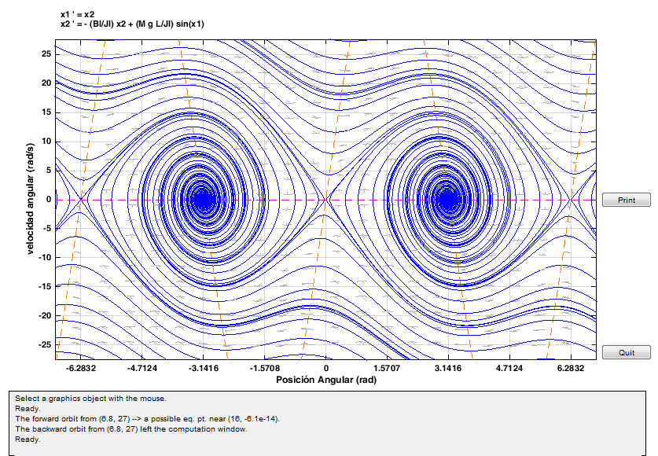
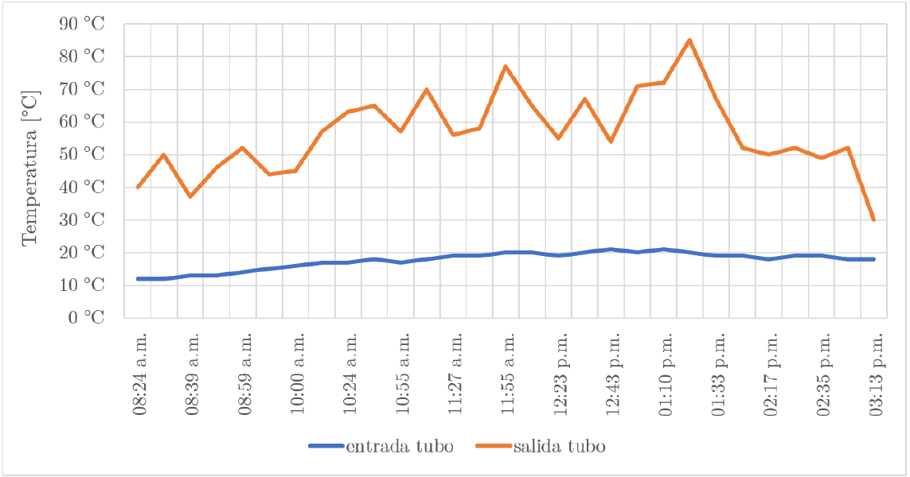
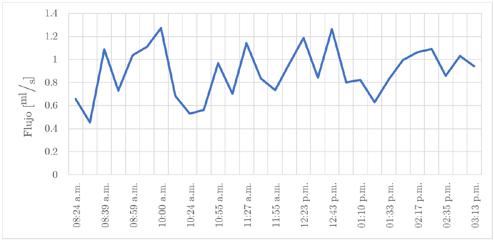

[← Volver al portfolio](../portfolio)

# Colector solar cilindro-parabólico con seguimiento

Proyecto de grado, Ingeniería Electrónica, Universidad Mayor de San Andrés.  
Mecánica en Solid Edge ST7, control y adquisición en LabVIEW sobre NI myRIO, modelado en MATLAB/Simulink. Prototipo construido y probado en campo.

{: width="520"}

## Resumen

Diseñé y construí un colector térmico de canal parabólico (PTC) que gira sobre un eje para seguir al sol durante el día. El reflector concentra la radiación sobre una cañería de cobre ubicada en la línea focal, por donde circula agua. Hice el diseño mecánico, el modelo dinámico, el controlador de posición en la myRIO y las pruebas del prototipo.

En las pruebas, el error de posición fue de 0,19° en lazo cerrado y 0,12° en lazo abierto. El agua salió del receptor a 85 °C como máximo, con entrada entre 12 y 21 °C.

## Mecánica

El ensamble mide unos 840 × 1640 × 1186 mm. El reflector es una plancha cóncava apoyada sobre seis perfiles parabólicos con ángulo de borde de 80°. El perfil sale de un estudio previo de radiación solar, de cómo interactúa con distintos materiales y de la posición del sol vista desde la Tierra.

Todo el conjunto gira sobre un eje principal montado en chumaceras. Diseñé una caja reductora con sectores dentados para poder moverlo con un motor DC pequeño, de 20 W nominales, recuperado de chatarra electrónica. Con los parámetros calculados de ese motor elegí el driver BTS7960.

Pasé por tres versiones del colector, dos de los soportes al piso y tres del motorreductor. Para la estructura comparé la masa con tres maderas: 1,8 kg con balsa, 2,8 kg con mapajo y 4,5 kg con la madera disponible en el taller, incluida la plancha acrílica.

{: width="560"}

{: width="520"}

## Modelo y control

Modelé el colector como un péndulo físico con fricción viscosa:

```
x1' = x2
x2' = -(B/J)·x2 + (M·g·L/J)·sin(x1)
```

El retrato de fase muestra un punto de silla en 0 rad y centros en ±π. La posición de trabajo es inestable: sin par del motor, el colector cae hacia uno de los lados. Por eso el controlador tiene que sostener la posición además de seguir la referencia.

{: width="640"}

La propuesta inicial era un PID adaptativo. Las simulaciones mostraron que la saturación del actuador lo hacía fallar, y el anti-windup no alcanzó para corregirlo. Lo cambié por realimentación de estados más un PID con modelo de referencia. El proceso fue el de siempre: identificar los parámetros de la planta, linealizar el modelo, diseñar el controlador y validarlo en Simulink antes de pasarlo al hardware.

## Sensores e implementación en myRIO

El lazo cerrado combina tres medidas:

- encoder en el eje del motor;
- inclinación con un BMX055 (acelerómetro en el rango de ±2 g);
- posición del sol con una cámara Pixy2, que procesa la imagen en su propio procesador y deja libre a la myRIO.

El programa está repartido entre la FPGA y el procesador de tiempo real de la myRIO. La FPGA lee el encoder, genera el PWM del puente H y mide la corriente. El procesador de tiempo real calcula los ángulos solares y el mediodía solar, sincroniza el reloj con NIST, lee la IMU y ejecuta el lazo de posición.

{: width="720"}

## Resultados

En un día completo de prueba, el colector fue de −88° cerca de las 06:50 a +73° a las 17:00. Al inicio y al final del día trabaja en "modo reloj", con la posición calculada a partir de la hora. En seguimiento, el error se mantuvo casi siempre dentro de ±0,2°.

{: width="760"}

En la prueba térmica, entre las 08:24 y las 15:13, el agua entró al receptor a 12-21 °C y salió con picos de 85 °C alrededor de las 13:20. El caudal varió entre 0,45 y 1,27 ml/s.

{: width="700"}

{: width="700"}

El reflector concentró bien la radiación, pero el rendimiento térmico fue bajo. El receptor no tenía revestimiento selectivo ni envolvente de vidrio al vacío, así que perdía buena parte del calor por convección y radiación. Es lo primero que cambiaría en una segunda versión.

Hay otro punto a mejorar. La Pixy2 detecta el sol sin problemas, pero apuntarla directo al sol durante meses probablemente la termine dañando. Una versión siguiente necesita un filtro de densidad neutra o un sensor solar dedicado.

Como primera versión, el prototipo sirve como base para experimentar con energía solar en la Facultad de Ingeniería de la UMSA.

## Herramientas

Solid Edge ST7 · LabVIEW (RT y FPGA) · NI myRIO · MATLAB/Simulink · Proteus · BTS7960 · BMX055 · Pixy2
