[← Volver al portfolio](../portfolio)

# Colector solar cilindro-parabólico con seguimiento

Proyecto de grado, Ingeniería Electrónica, Universidad Mayor de San Andrés.  
Mecánica en Solid Edge, control y adquisición en LabVIEW sobre NI myRIO, modelado en MATLAB/Simulink. Prototipo construido y probado en campo.

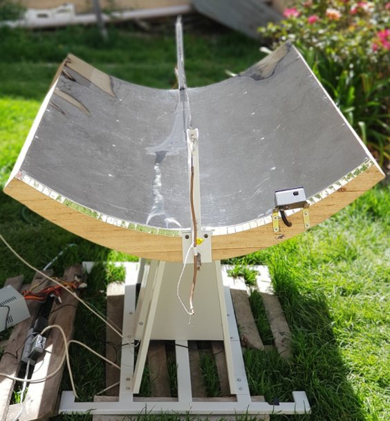{: width="460"}

## Resumen

Diseñé y construí un colector térmico de canal parabólico (PTC) que gira sobre un eje norte-sur para seguir al sol de este a oeste. El reflector concentra la radiación sobre una cañería de cobre en la línea focal, por donde circula agua. Hice el diseño mecánico, la caja reductora, el modelo dinámico, el controlador en la myRIO y las pruebas del prototipo.

En las pruebas, el error de seguimiento fue de 0,19° con la cámara (lazo cerrado) y de 0,12° en modo reloj (lazo abierto). El agua salió del receptor a 85 °C como máximo.

## Reflector y estructura

El perfil parabólico tiene un ángulo de borde de 80°, distancia focal de 269 mm, apertura de 903 mm y 1400 mm de largo. Lo calculé partiendo de un estudio de radiación solar y de la posición del sol vista desde la Tierra. La superficie reflectiva va apoyada sobre seis perfiles de madera cortados con esa curva, y todo el conjunto gira sobre un eje en chumaceras montadas en una estructura metálica.

| | |
|---|---|
| 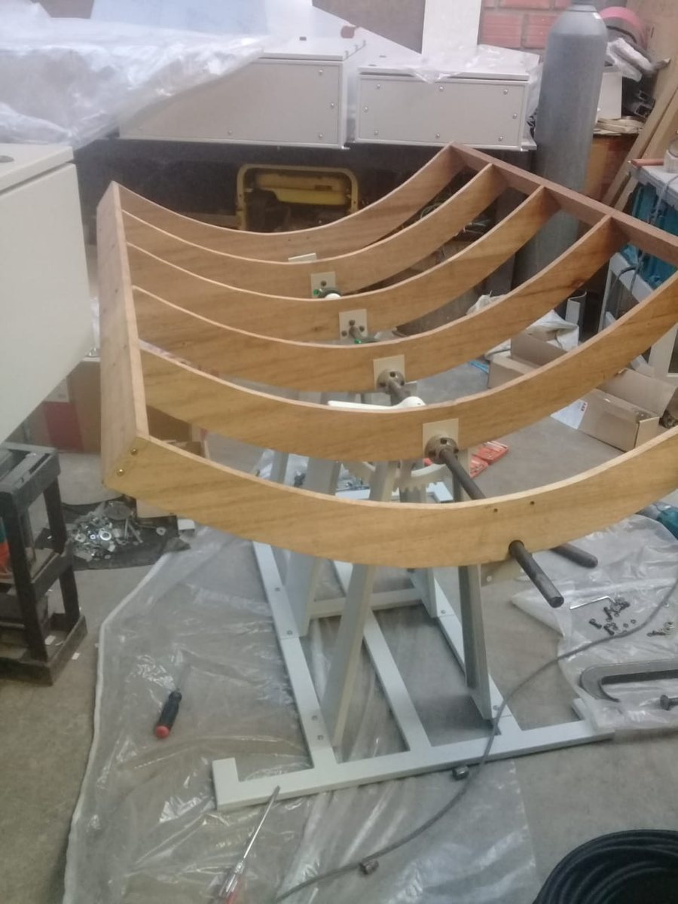 | 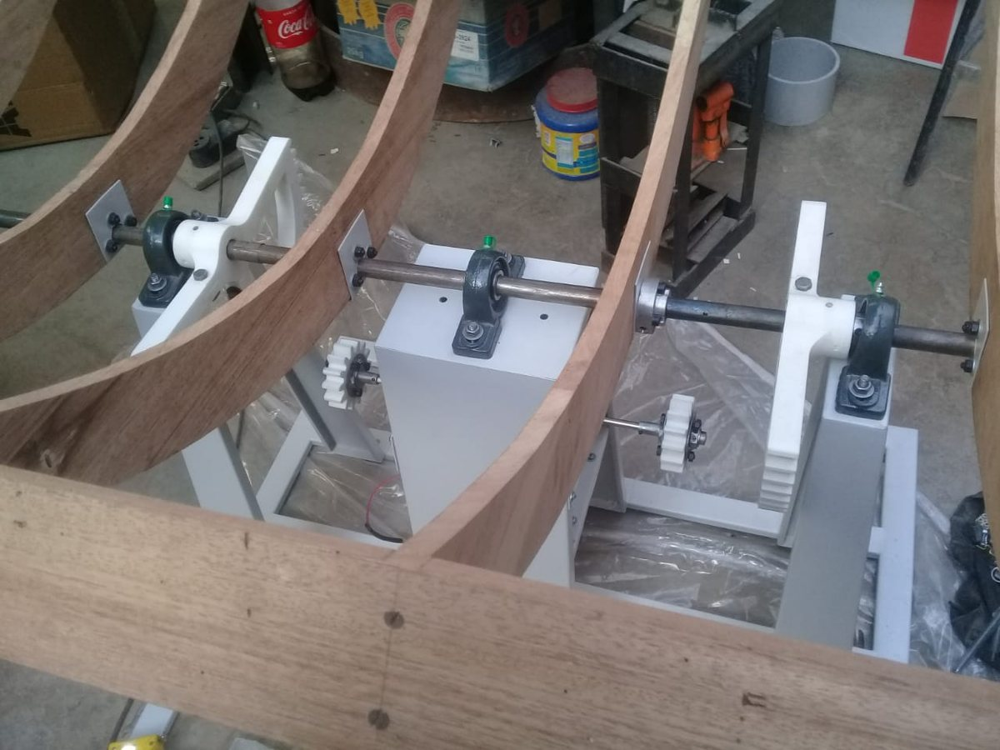 |
| Perfiles parabólicos en construcción | Eje, chumaceras y sectores dentados |

En la foto se ve cómo los rayos se cruzan sobre el receptor. A pesar de las imperfecciones de construcción, la parábola concentra la radiación sobre la línea focal.

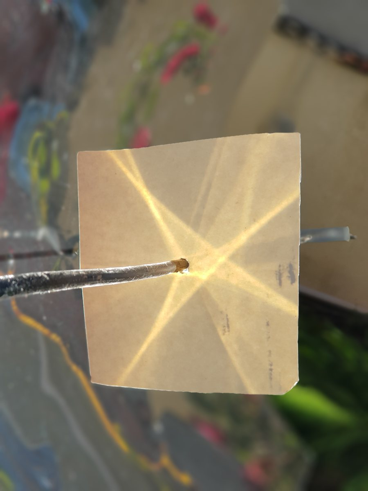{: width="380"}

## Caja reductora

El colector se mueve con un motor DC de 12 V y 20 W recuperado de chatarra electrónica, que da unos 42 mN·m. Para mover el colector con ese par diseñé una caja de cinco etapas con relación total 1:978, que entrega unos 41 N·m en el eje. Los engranajes los calculé con la herramienta de engranajes rectos de Solid Edge, empezando por el último par (14 y 61 dientes), que es el que carga el par del colector. Con los parámetros del motor elegí el driver BTS7960.

| | |
|---|---|
| 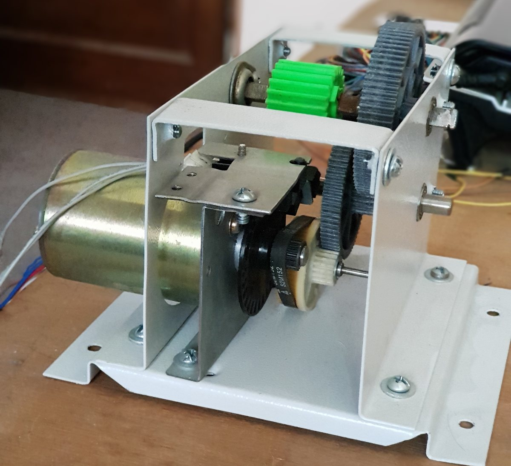 | 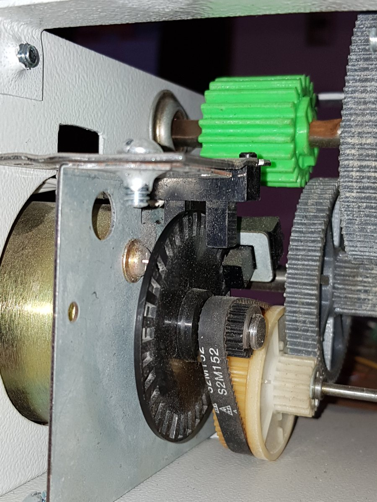 |
| Motorreductor armado | Encoder: disco ranurado y fotointerruptores |

{: width="520"}

## Modelo y control

Modelé el colector como un péndulo físico con fricción viscosa:

```
x1' = x2
x2' = -(B/J)·x2 + (M·g·L/J)·sin(x1)
```

El retrato de fase muestra un punto de silla en 0 rad y centros en ±π. La posición de trabajo es inestable: sin par del motor, el colector cae hacia uno de los lados. Por eso el controlador tiene que sostener la posición además de seguir la referencia.

{: width="640"}

La propuesta inicial era un PID adaptativo. Las simulaciones mostraron que la saturación del actuador lo hacía fallar, y el anti-windup no alcanzó para corregirlo. Lo cambié por realimentación de estados más un PID con modelo de referencia. Identifiqué los parámetros del motor, linealicé el modelo, diseñé el controlador y lo validé en Simulink y LabVIEW antes de pasarlo al hardware.

## Sensores e implementación en myRIO

El lazo cerrado combina tres medidas:

- un encoder incremental hecho con un disco ranurado en el eje del motor y dos fotointerruptores Sharp GP1A05;
- la inclinación del colector, con un BMX055 (acelerómetro en el rango de ±2 g);
- la posición del sol, con una cámara Pixy2 que procesa la imagen en su propio procesador y deja libre a la myRIO.

| | |
|---|---|
| 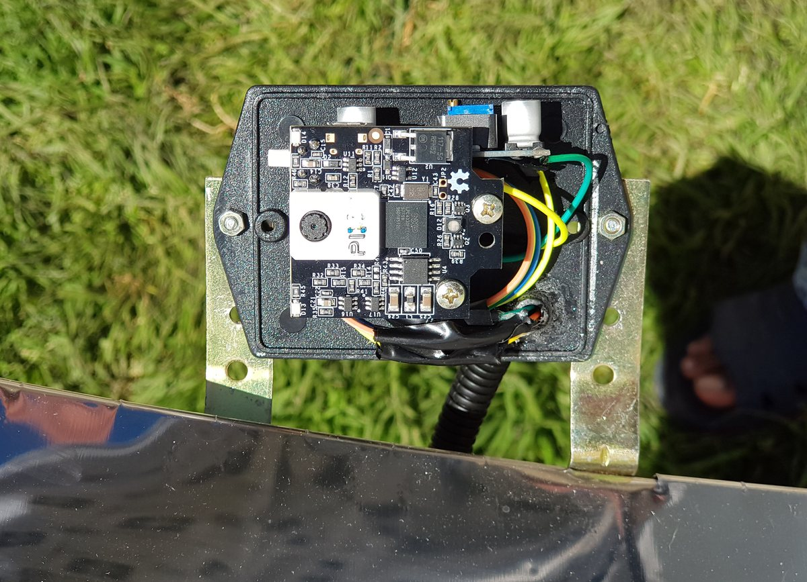 | 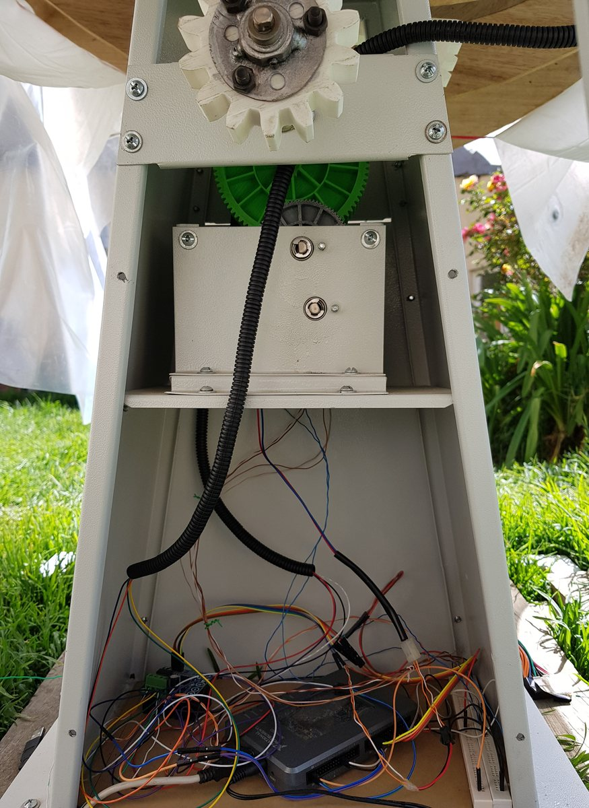 |
| Pixy2 montada en el borde del reflector | Electrónica de control en la base |

El programa está repartido entre la FPGA y el procesador de tiempo real de la myRIO. La FPGA mide el tiempo entre pulsos del encoder con un reloj de 40 MHz, genera el PWM del puente H y lee la corriente. El procesador de tiempo real calcula los ángulos solares, sincroniza el reloj con NIST, lee la IMU y ejecuta el lazo de posición.

Hay dos modos de seguimiento. Normalmente sigue al sol con la Pixy2. Cuando la cámara pierde el sol (sombras al amanecer y al atardecer, nubes), el sistema pasa solo a "modo reloj" y sigue una referencia calculada con la hora y la posición solar. Al volver a ver el sol, regresa al seguimiento por cámara.

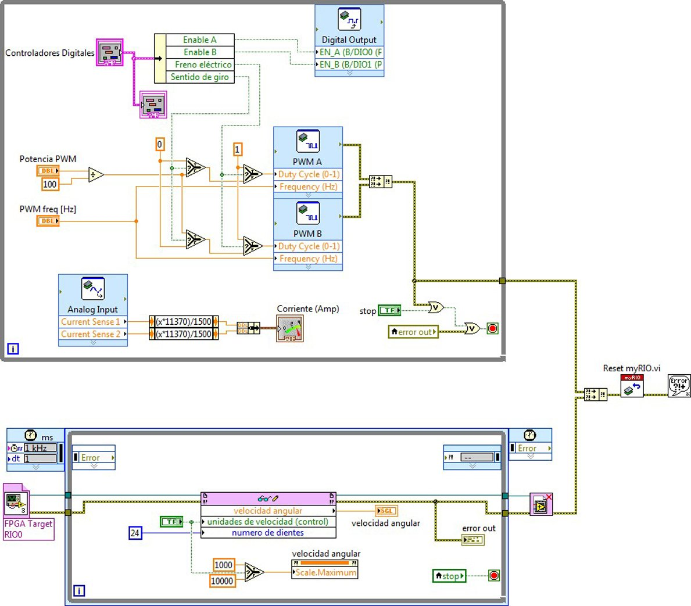{: width="720"}

## Resultados

Ante un cambio de referencia de 0° a 30°, el colector llega en 11,8 s con 1,38 % de sobrepico. Con pasos de 1° cada 20 s, que se parecen a lo que pide el seguimiento real, el sobrepico máximo fue de 0,5° y el PID lo corrige enseguida.

En un día completo, el colector fue de −88° en la mañana a +73° en la tarde. Al inicio y al final del día trabaja en modo reloj, y en el resto sigue con la cámara. El error en modo reloj fue de 0,12° ± 0,03°. En modo cámara, el error mínimo medible es un píxel de la Pixy2, 0,19°. Ambos valores caen en el rango de los seguidores publicados en la literatura, que va de 0,01° a 1°.

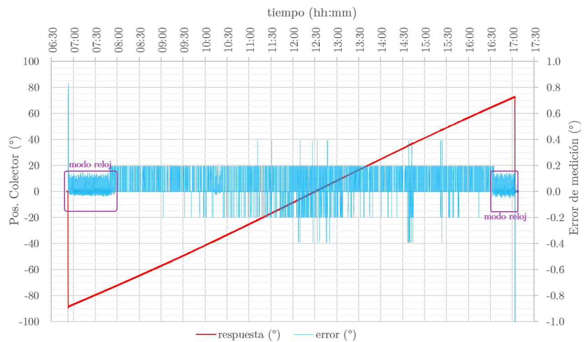{: width="760"}

Cerca de 0° se ven pequeñas correcciones bruscas. Ahí el par de la gravedad sobre el colector es casi cero y aparece el juego entre los últimos engranajes, así que el controlador corrige todo el tiempo. Lejos del centro la carga mantiene los dientes en contacto y el control es más fino.

En la prueba térmica el agua entró al receptor a 12-21 °C y salió con picos de 85 °C, con un caudal de entre 0,45 y 1,27 ml/s.

{: width="700"}

{: width="700"}

## Qué cambiaría

- El receptor no tenía revestimiento selectivo ni envolvente de vidrio al vacío, y perdía mucho calor. Es la mejora térmica más importante.
- La Pixy2 detecta bien el sol, pero apuntarla directo al sol durante meses probablemente la dañe. Durante el proyecto probé también una [cámara térmica MLX90640](camara-termica-myrio) como sensor, y esas pruebas me llevaron a la conclusión de que para detectar el sol conviene trabajar en ultravioleta, donde casi no hay interferencia de otras fuentes.
- Reducir el juego en la última etapa de engranajes mejoraría la precisión cerca de 0°.

## Modelo 3D

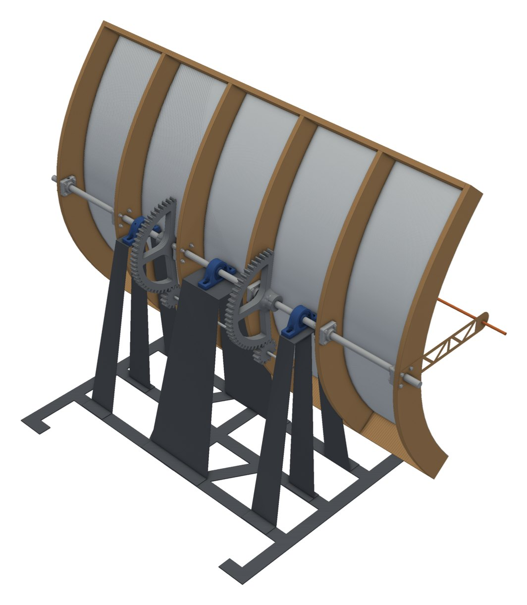{: width="520"}

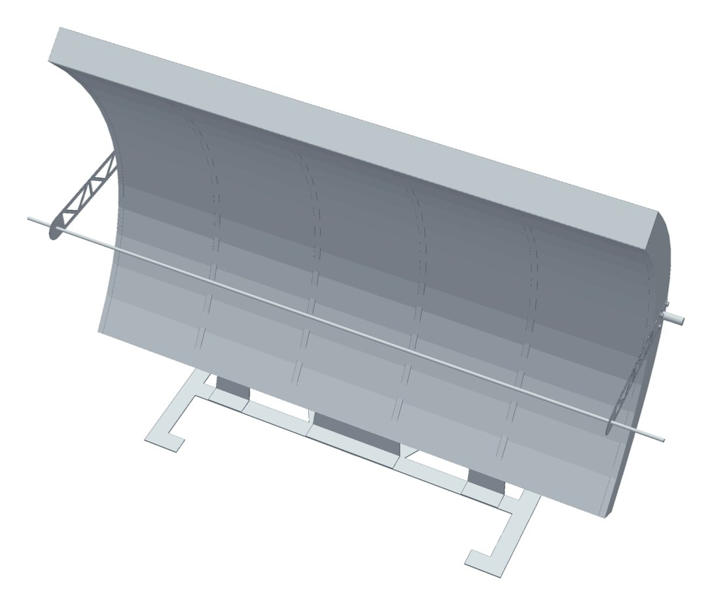{: width="560"}

## Herramientas

Solid Edge · LabVIEW (RT y FPGA) · NI myRIO · MATLAB/Simulink · Proteus · BTS7960 · BMX055 · Pixy2 · Sharp GP1A05
