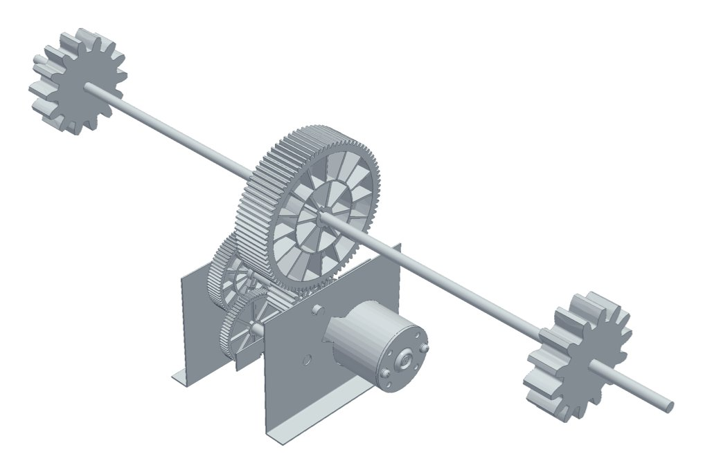

[← Volver al portfolio](../portfolio)

# Colector solar cilindro-parabólico con seguimiento

Proyecto de grado, Ingeniería Electrónica, Universidad Mayor de San Andrés. [COMPLETAR: año de defensa]  
Mecánica en Solid Edge, control y adquisición en LabVIEW sobre NI myRIO, modelado en MATLAB/Simulink.


## Resumen

Diseñé un colector térmico de canal parabólico que gira sobre un eje para seguir al sol durante el día. El reflector concentra la radiación sobre una cañería de cobre ubicada en la línea focal. Hice el diseño mecánico completo, el modelo dinámico del sistema y el controlador de posición en la myRIO, con el ángulo de referencia calculado a partir de la posición solar.

Trabajo individual. [COMPLETAR: confirmar; nombre del tutor si quieres citarlo]

## Mecánica

El ensamble mide unos 840 × 1640 × 1186 mm (versión de noviembre de 2018). El reflector es una plancha cóncava apoyada sobre seis perfiles parabólicos con ángulo de borde de 80°. Todo el conjunto gira sobre un eje principal montado en chumaceras, y lo mueve un motor DC con caja reductora a través de dos sectores dentados.

Pasé por tres versiones del colector (2018), dos de los soportes al piso (2018 y 2019), tres del motorreductor y una revisión final en marzo de 2022. Para elegir el material de la estructura calculé la masa con tres maderas: 1,8 kg con balsa, 2,8 kg con mapajo y 4,5 kg con la madera disponible en el taller, incluida la plancha acrílica.




## Modelo y control

Modelé el colector como un péndulo físico con fricción viscosa:

```
x1' = x2
x2' = -(B/J)·x2 + (M·g·L/J)·sin(x1)
```

El retrato de fase muestra un punto de silla en 0 rad y centros en ±π. La posición de trabajo es inestable: sin par del motor, el colector cae hacia uno de los lados. Por eso el controlador tiene que sostener la posición además de seguir la referencia.


En Simulink identifiqué los parámetros de la planta (modelo de segundo orden del motor DC) y probé controladores por espacio de estados, con y sin observador de orden mínimo, y un PID. Después llevé el control a LabVIEW en tres versiones del seguidor (SS + PID), la última con una cámara Pixy2 para corregir la posición por visión.

## Implementación en myRIO

El programa está dividido entre la FPGA y el procesador de tiempo real de la myRIO:

- FPGA: lectura del encoder, PWM del puente H y medición de corriente.
- Tiempo real: cálculo de los ángulos solares y del mediodía solar, sincronización del reloj con NIST, lectura de acelerómetro y giróscopo para la inclinación, y el lazo de posición.

Probé dos drivers de motor, Monster Moto e IBT-2 (BTS7960). También simulé en Proteus un convertidor frecuencia-voltaje para el encoder, con LM2907 y con un PIC.


## Resultados

[COMPLETAR: ¿se construyó el prototipo? ¿qué error de seguimiento midió, en grados? ¿qué temperatura alcanzó el fluido o qué eficiencia? Una foto del prototipo vale más que cualquier render.]

## Herramientas

Solid Edge · LabVIEW (RT y FPGA) · NI myRIO · MATLAB/Simulink · Proteus
