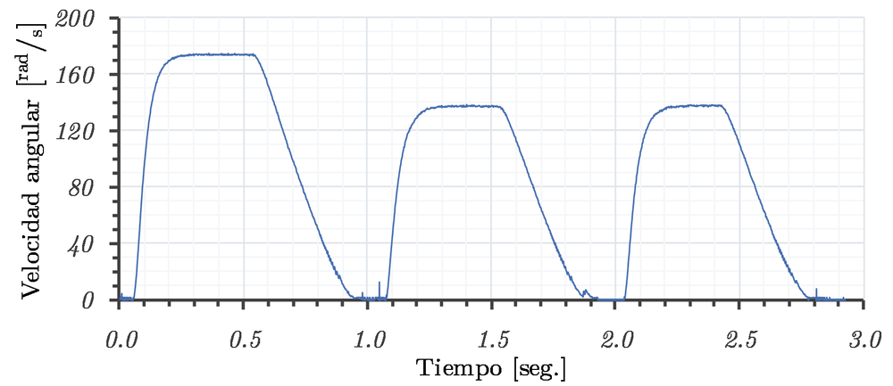
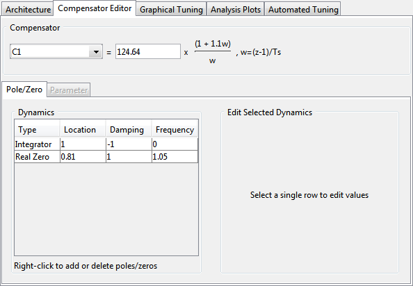
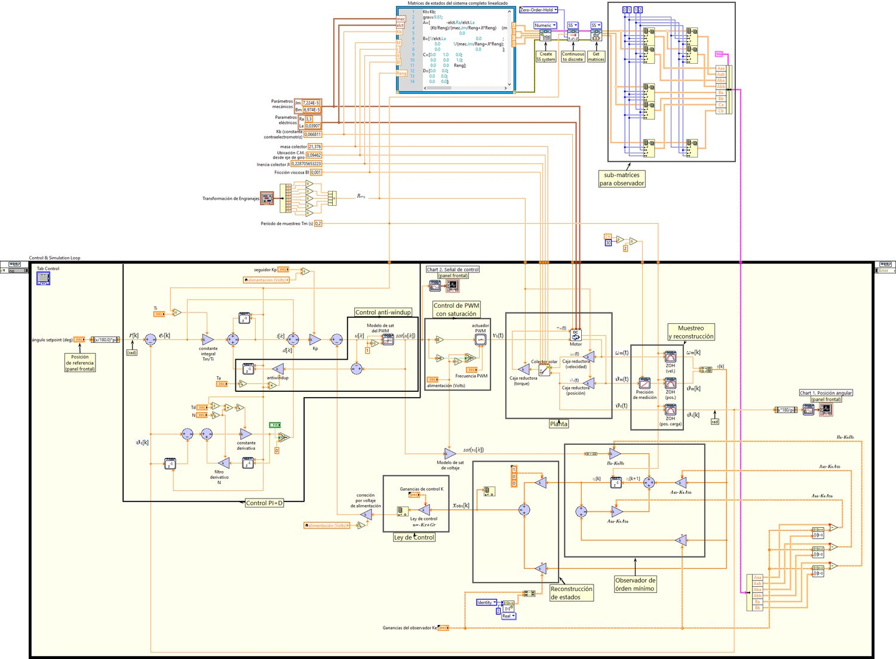
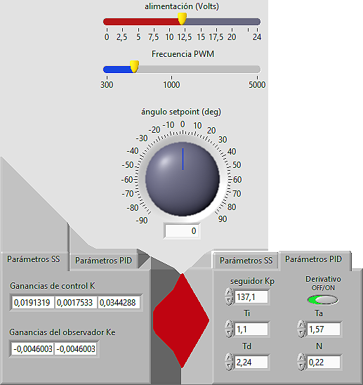
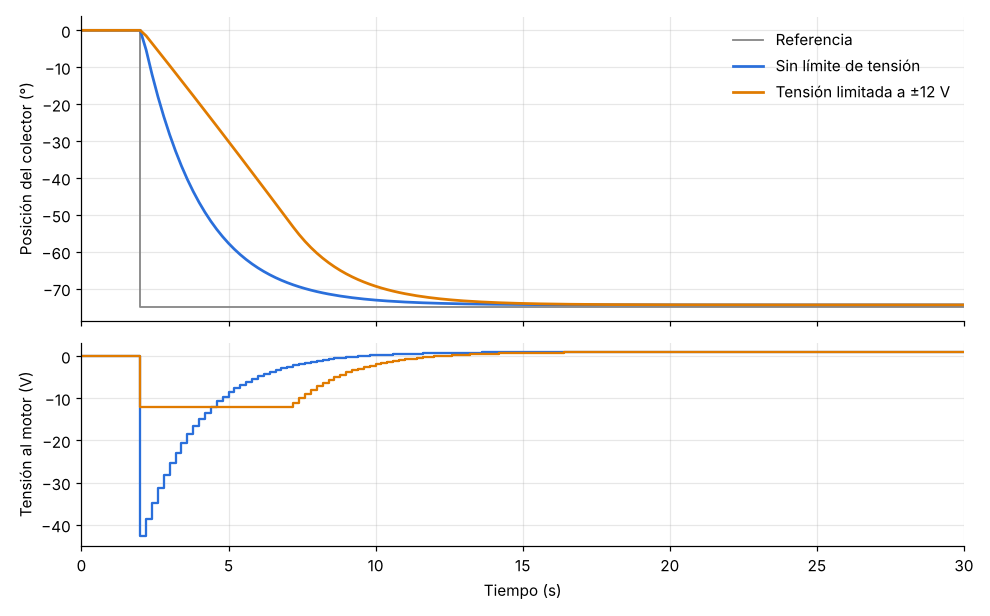
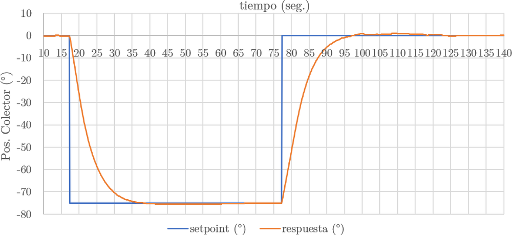

[← Volver al portfolio](../portfolio)

# Modelado y simulación del control del colector solar

Parte del proyecto del [colector solar con seguimiento](seguidor-solar-myrio). Antes de tocar el hardware identifiqué el motor, armé el modelo del motor con el colector, diseñé el controlador en MATLAB y lo simulé en LabVIEW. Esta página cubre esa parte.

## Identificación del motor

El motor es un PMDC Canon Nisca NC5475B, recuperado de equipos en desuso. Para medir su velocidad usé el encoder del motor y un LM2907 (conversor de frecuencia a tensión) como tacómetro. Apliqué escalones de tensión, registré entrada y salida con el osciloscopio y pasé los datos a la herramienta `ident` de MATLAB.

{: width="640"}

El modelo de segundo orden que mejor ajustó, de tensión a velocidad:

```
ω(s)         0.0668
------ = -----------------------------------
V(s)     2.82e-6 s² + 2.41e-4 s + 4.69e-3
```

De ahí salen los parámetros físicos:

| Parámetro | Valor |
|---|---|
| Resistencia de armadura Ra | 3,3 Ω |
| Inductancia La | 39,07 mH |
| Constante de par Kt = Kb | 0,0668 N·m/A |
| Inercia del rotor Jm | 7,22·10⁻⁵ kg·m² |
| Fricción viscosa Bm | 6,97·10⁻⁵ N·m·s/rad |

## Modelo del motor con el colector

El motor mueve el colector a través de un reductor de 1:978,3. El colector se comporta como un péndulo físico: 21,4 kg con el centro de masa a 9,5 cm del eje. Con corriente, velocidad y posición como estados, el modelo es no lineal por el término del seno.

Linealizado en la posición de trabajo tiene tres polos reales: −55,6 y −29,8 s⁻¹ (estables) y +0,015 s⁻¹ (inestable). El polo inestable es lento, pero está: sin par del motor, el colector cae hacia un lado.

El período de muestreo quedó en 200 ms. La cámara Pixy2 tarda unos 80 ms en entregar el error de seguimiento ya filtrado, en el mejor caso a 60 fps, y no siempre llega a esa tasa. Con 200 ms queda margen.

## Diseño del controlador

**Realimentación de estados.** Discreticé el modelo y calculé las ganancias con `place`. Conservé los dos polos estables y moví el inestable a −0,5 s⁻¹. La ganancia queda K = [0,0191  0,00175  0,0344]. Un observador de orden mínimo, tres veces más rápido que el polo más rápido del lazo, estima la corriente de armadura. La ganancia de seguimiento sale del teorema del valor final.

**PID de dos grados de libertad.** Encima de la realimentación de estados va un PI+D: el PI (C1) sigue la referencia y el derivativo filtrado (C2) rechaza perturbaciones de carga sin reaccionar a los saltos de referencia. Lo sintonicé moviendo polos y ceros sobre el lugar de raíces discreto en Control System Designer (`sisotool`):

```
C1 (PI):              124.64 · (1.1w + 1) / w
C2 (D filtrado):      307.55 · w / (10w + 1)          w = (z − 1) / Tm
```

{: width="480"}

El actuador se satura, así que el integrador lleva anti-windup con Ta = √(Ti·Td).

Antes de llegar a este esquema probé en simulación un PD adaptativo propio y un PID adaptativo con el algoritmo de Bobál. Con la saturación del actuador ninguno respondió bien, y los descarté.

## Simulación en LabVIEW

Las primeras versiones del lazo (realimentación de estados, con observador y con el PID) las armé en Simulink. La simulación más completa la hice por partes en LabVIEW: motor PMDC, motor con reductor, colector como péndulo, modulación PWM y al final el lazo completo con el observador, el PI+D, el anti-windup y el muestreo. El panel permite cambiar la tensión de alimentación, la frecuencia PWM, el ángulo de referencia y todas las ganancias mientras corre.



{: width="420"}

## Reproducción en Python

Para esta página porté el script de diseño a Python ([servocontrol_colector.py](../assets/code/simulacion-control/servocontrol_colector.py)). Las ganancias que calcula son las mismas que usa el panel de LabVIEW. La simulación usa el modelo no lineal y solo la realimentación de estados, con un escalón de −75°:

{: width="720"}

Sin límite de tensión el lazo pide más de 40 V al arrancar. Con la tensión limitada a ±12 V llega en unos 11 s. En los dos casos se detiene en −74,4°: la realimentación de estados se diseñó sobre el modelo lineal, y el seno deja un error de 0,6°. La acción integral del PI de C1 es la que corrige ese tipo de error.

## Resultado en el prototipo

Con el controlador cargado en la myRIO, el colector real respondió así a una referencia de −75° y de vuelta a 0°:

{: width="720"}

El seguimiento durante un día completo está en la [página del colector](seguidor-solar-myrio).

## Herramientas

MATLAB (System Identification, Control System Designer) · Simulink · LabVIEW · Python (NumPy, SciPy) · NI myRIO
